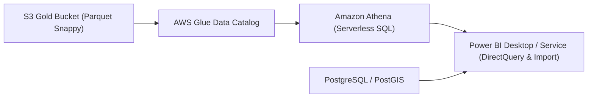

# AgroSense Café — Power BI Analytics, Athena Connector & Dashboard Setup Guide
**Jira References:** `SCRUM-46` (`SCRUM-186`, `SCRUM-187`, `SCRUM-188`, `SCRUM-200`, `SCRUM-201`)
**Target Environment:** Power BI Desktop / Power BI Service / Amazon Athena (ODBC)
**Catalog Database:** `agrosense_datalake` (S3 Gold Layer: `s3://datalakeagrosense/gold/`)

---

## 1. Architecture & Data Connectivity Overview



### Supported Connectors (SCRUM-186 & SCRUM-201)
1. **DirectQuery via Amazon Athena:** For real-time exploration of Gold Fact and Dimension tables (`fact_entregas`, `fact_alertas`, `dim_finca`, `dim_tiempo`) without loading gigabytes of data locally into memory.
2. **Import via PostgreSQL:** For operational and audit queries requiring PostGIS spatial boundaries and multi-tenant security filters.

---

## 2. AWS Glue Catalog & Athena Configuration (SCRUM-200)

1. **Verify Glue Catalog Database:**
   ```sql
   CREATE DATABASE IF NOT EXISTS agrosense_datalake
   LOCATION 's3://datalakeagrosense/gold/';
   ```
2. **Athena Query Result Location Setup:**
   Ensure Athena's primary workgroup outputs query results to a dedicated prefix:
   `s3://datalakeagrosense/athena-query-results/`
3. **Glue Crawler / DDL Registration:**
   Execute `infra/aws/glue_athena_medallion_catalog.sql` to register all 4 dimensional Gold tables (`dim_finca`, `dim_tiempo`, `fact_entregas`, `fact_alertas`).

---

## 3. Power BI Desktop ODBC Connector Setup (SCRUM-201)

### 3.1 Driver Installation
Download and install the official **Simba Amazon Athena ODBC Driver** (64-bit) from the AWS documentation.

### 3.2 DSN Configuration Steps
1. Open **ODBC Data Source Administrator (64-bit)** in Windows.
2. Select **System DSN** $\to$ **Add** $\to$ **Simba Athena ODBC Driver**.
3. Fill in connection properties:
   - **Data Source Name:** `AgroSense_Athena_Gold`
   - **AWS Region:** `us-east-2` (or target region)
   - **Catalog:** `AwsDataCatalog`
   - **Database:** `agrosense_datalake`
   - **Workgroup:** `primary`
   - **S3 Output Location:** `s3://datalakeagrosense/athena-query-results/`
   - **Authentication:** IAM Credentials (`AWS_ACCESS_KEY_ID` & `AWS_SECRET_ACCESS_KEY` or AAD/SAML federated role).

---

## 4. Visual Dashboards Specification (SCRUM-187)

The Power BI report contains 3 core analytical dashboard pages designed to answer the cooperative's fundamental business questions:

### Page 1: Executive Farm Traceability & Harvest Volume
- **KPI Cards:** Total Traceable Volume (Kg), Certified Export Lots, Active International Buyers.
- **Visuals:**
  - Harvest delivery timeline (Month-over-Month growth by coffee variety: Castillo, Caturra, Geisha).
  - Top 10 Contributing Farms ranked by delivered yield.

### Page 2: Agronomic Risk & Early Warning Visualizer
- **Visuals:**
  - Active Alarms by Type (`COFFEE_RUST`, `WATER_DEFICIT`, `EXTREME_RAIN`) over time.
  - Heatmap matrix: Farm vs 72-hour cumulative precipitation.
  - Prioritized agronomist field visit table sorted by composite risk score.

### Page 3: Water Footprint & Sustainability Compliance
- **Visuals:**
  - Water Footprint distribution ($L/\text{kg}$ of green coffee exported) across micro-climates.
  - Comparison of direct irrigation vs captured satellite rainfall.

---

## 5. Interactive PostGIS Farm Map Visualizer & Buyer Access (SCRUM-188)

### 5.1 Geospatial Polygon Visualizer
- Uses the **Mapbox / Azure Maps** visual in Power BI.
- Bound to `dim_finca.latitude` and `dim_finca.longitude` with embedded GeoJSON boundaries for plot-level drilldowns.

### 5.2 Multi-Tenant Buyer Row-Level Filtering (RLS in Power BI)
To mirror PostgreSQL's `RN-11` buyer isolation in Power BI:
1. In Power BI Desktop, navigate to **Modeling** $\to$ **Manage Roles**.
2. Create role `InternationalBuyerRole`:
   ```dax
   [buyer_id] = USERNAME()
   ```
3. When shared in Power BI Service, international buyers strictly view lots and metrics assigned to their commercial organization.
