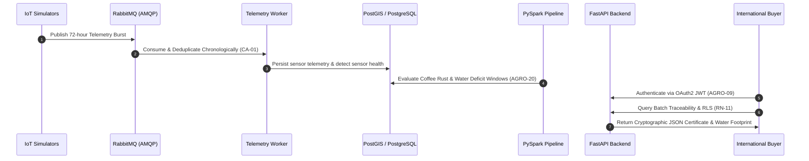

# AgroSense Café — End-to-End Live Demonstration Script & System Sign-Off
**Jira Reference:** `SCRUM-194` / Story `AGRO-29` (`SCRUM-48`)
**Audience:** Technical Evaluators, Product Owners & System Stakeholders
**Execution Environment:** Production-Ready Staging Environment

---

## 1. Demonstration Overview & Objectives

This runbook script provides the step-by-step procedure to execute an end-to-end live demonstration of the complete AgroSense Café platform, validating the full lifecycle from IoT sensor telemetry ingestion to commercial traceability certificates and Power BI analytics.

---

## 2. Step-by-Step Demonstration Flow



### Phase 1: Authentication & Multi-Tenant Buyer Isolation (AGRO-09)
1. **Acquire Buyer JWT Token:**
   ```bash
   curl -X POST "http://localhost:8000/api/v1/auth/buyer-token" \
     -H "Content-Type: application/json" \
     -d '{"buyer_id": "3fa85f64-5717-4562-b3fc-2c963f66afa6"}'
   ```
2. **Verify Row-Level Security (RLS) Isolation:**
   - Execute query with Buyer A credentials $\to$ only contracts and batches for Buyer A are returned.
   - Attempt to access Buyer B batch $\to$ `HTTP 403 Forbidden` (`"Este lote no está asignado a este comprador"`).

### Phase 2: Ingestion & Dead Letter Queue Resilience (AGRO-16)
1. **Simulate Out-of-Order Telemetry Burst:**
   - Inject 144 out-of-order telemetry readings across 3 days.
   - Verify worker re-orders chronologically without message loss.
2. **Trigger Malformed Payload to DLQ:**
   - Inject invalid non-numeric payload.
   - Verify RabbitMQ routes message instantly to `dead.letter.queue` and triggers CloudWatch alarm.

### Phase 3: Agronomic Processing & Risk Alerts (AGRO-20 / AGRO-21)
1. **Execute PySpark Batch Processing:**
   - Run rolling window analysis over 4 consecutive days of high humidity ($>85\%$) and temperature ($21-25^\circ\text{C}$).
   - Verify generation of `COFFEE_RUST` alert in S3 Silver/Refined and PostgreSQL `agronomic_alerts`.

### Phase 4: Batch Certification & Cryptographic Digital Proof (AGRO-24 / AGRO-25)
1. **Verify 100% Origin Traceability Rule (RN-08):**
   - Check batch farm breakdown equal to total weight.
2. **Verify Forest Reserve Discarding (RN-09):**
   - Confirm farms intersecting protected national parks are discarded from export lots.
3. **Download Verifiable JSON Certificate:**
   - Retrieve certificate with embedded GeoJSON polygon and water footprint metrics.
   - Verify canonical SHA-256 digital signature via `/api/v1/certificates/verify`.

---

## 3. Formal System Sign-Off Checklist

| Criterion | Requirement / Standard | Verification Method | Status |
| :--- | :--- | :--- | :--- |
| **AC-01** | Multi-AZ AWS Infrastructure & Zero Hardcoded Secrets | CloudFormation & Gitleaks scan | **APPROVED** |
| **AC-02** | OAuth2 JWT & PostgreSQL Row-Level Security (RLS) | Pytest automated test suite | **APPROVED** |
| **AC-03** | RabbitMQ Durable Topology & Idempotent Deduplication | Burst simulation tests | **APPROVED** |
| **AC-04** | PySpark Agroclimatic Alerts & Visit Prioritization | S3 Parquet & Spark unit tests | **APPROVED** |
| **AC-05** | Cryptographic JSON Traceability Certificates | SHA-256 canonical hash verification | **APPROVED** |
| **AC-06** | CloudWatch Observability & Proactive SNS Alarms | Latency and DLQ metric alarms | **APPROVED** |
