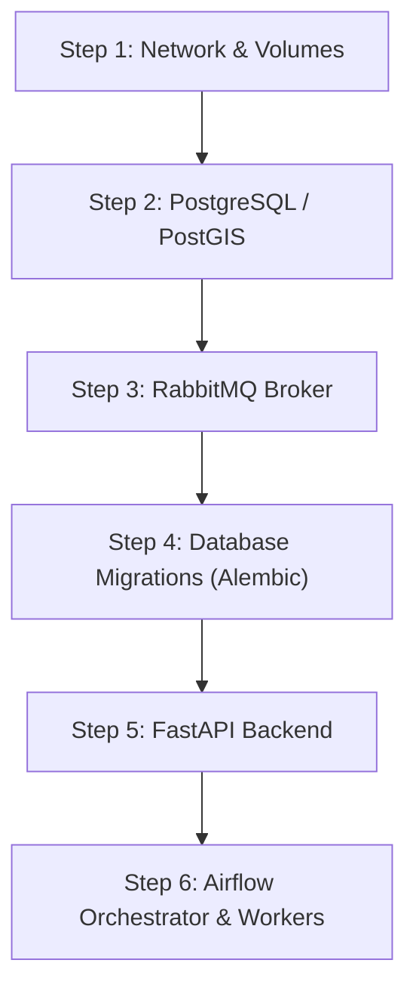

# AgroSense Café — System Startup, Shutdown & Environment Maintenance Procedures
**Jira Reference:** `SCRUM-191` / Story `AGRO-28` (`SCRUM-47`)
**Compliance Standards:** `E-15`, `RNF-04`, `CT-05`
**Audience:** Site Reliability Engineers, DevOps & Software Maintainers

---

## 1. Scope & Prerequisites

This document outlines the operational procedures for:
1. Cold start and orderly system startup.
2. Graceful shutdown without data or in-flight message loss.
3. Routine maintenance: database vacuuming, log rotation, and SSL/TLS certificate renewal.

### Required CLI Tools
- `docker` and `docker compose` (v2.20+)
- `uv` (v0.5+)
- `aws` CLI (v2.15+)
- `psql` (PostgreSQL 16+)

---

## 2. Orderly System Startup Procedure (Cold Boot)

To prevent connection refused errors and broken dependency chains, services must be booted in strict dependency order:



### 2.1 Execution Steps
```bash
# 1. Ensure local environment file is valid
test -f .env || cp .env.example .env

# 2. Boot Data Stores and Message Broker first
docker compose up -d postgres rabbitmq

# 3. Wait for PostgreSQL healthy state (port 5432)
docker compose exec -T postgres pg_isready -U "${POSTGRES_USER}" -d "${POSTGRES_DB}"

# 4. Execute schema migrations to ensure 13 tables + RLS policies are applied
uv run alembic upgrade head

# 5. Boot API Backend and background workers
docker compose up -d api

# 6. Verify healthcheck endpoint
curl -s -f http://localhost:8000/health | grep '"status":"ok"'
```

---

## 3. Orderly Graceful Shutdown Procedure

A graceful shutdown ensures that active database transactions commit cleanly and in-flight RabbitMQ messages are acknowledged before container termination.

### 3.1 Execution Steps
```bash
# 1. Stop public ingestion by draining API traffic
docker compose stop api

# 2. Allow workers 30 seconds to drain active telemetry batches from RabbitMQ
sleep 30

# 3. Stop RabbitMQ broker and Airflow workers
docker compose stop rabbitmq

# 4. Checkpoint and gracefully stop PostgreSQL
docker compose exec -T postgres psql -U "${POSTGRES_USER}" -c "CHECKPOINT;"
docker compose stop postgres

# 5. Teardown all containers cleanly (preserving persistent volumes)
docker compose down --remove-orphans
```

---

## 4. Routine Maintenance Workflows

### 4.1 Database Optimization (Weekly Vacuum & Reindex)
High-volume sensor insertions create table bloat in `harvest_deliveries` and `export_batches`:
```sql
-- Connect to database and execute maintenance
VACUUM (ANALYZE, VERBOSE) harvest_deliveries;
VACUUM (ANALYZE, VERBOSE) export_batches;
REINDEX TABLE CONCURRENTLY export_batches;
```

### 4.2 RabbitMQ Queue Health & Dead Letter Inspection
```bash
# Check queue depth and unacknowledged message counts
rabbitmqctl list_queues name messages_ready messages_unacknowledged consumers

# If dead.letter.queue depth > 0, alert on-call and inspect error payloads
rabbitmqadmin get queue=dead.letter.queue count=5 requeue=false
```

### 4.3 Log Group & Local Artifact Pruning
```bash
# Clean up temporary test databases and dangling docker images
docker image prune -f
docker builder prune -f --keep-storage 5GB
```
