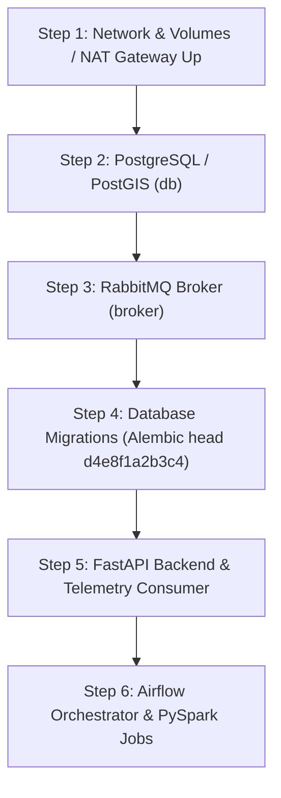

# AgroSense Café — System Startup, Shutdown & Environment Maintenance Procedures
**Jira Reference:** `SCRUM-191` / Story `AGRO-28` (`SCRUM-47`)
**Compliance Standards:** `E-15`, `RNF-04`, `CT-03`, `CT-05`
**Audience:** Site Reliability Engineers, DevOps & Software Maintainers

---

## 1. Scope & Prerequisites

This document outlines the operational procedures for:
1. Cold start and orderly system startup (Local Docker Compose & AWS ECS/EC2).
2. Graceful shutdown and FinOps cost-pause (`nat-toggle.sh`, `teardown.sh`) without data or in-flight message loss.
3. Routine maintenance: database vacuuming, RabbitMQ inspection, and post-sustentación teardown (`CT-03`).

### Required CLI Tools
- `docker` and `docker compose` (v2.20+)
- `uv` (v0.5+)
- `aws` CLI (v2.15+) or Python `boto3` (`infra/aws/aws_ops.py`)
- `psql` (PostgreSQL 16+)

---

## 2. Orderly System Startup Procedure (Cold Boot)

To prevent connection refused errors and broken dependency chains, services must be booted in strict dependency order:



### 2.1 Local Execution Steps (Docker Compose — `CT-01`)
```bash
# 1. Ensure local environment file is valid
test -f .env || cp .env.example .env

# 2. Boot Data Stores and Message Broker first
docker compose up -d db broker

# 3. Wait for PostgreSQL healthy state (port 5432)
docker compose exec -T db pg_isready -U "${POSTGRES_USER:-agrosense}" -d "${POSTGRES_DB:-agrosense_db}"

# 4. Execute schema migrations to ensure all 24 tables + FORCE RLS policies are applied
uv run alembic upgrade head

# 5. Boot API Backend, FastConsumer worker, and Airflow
docker compose up -d api telemetry-consumer airflow

# 6. Verify readiness and liveness endpoints
curl -s -f http://localhost:8000/health | grep '"status":"healthy"'
curl -s -f http://localhost:8000/health/live | grep '"status":"alive"'
```

### 2.2 AWS Demo Startup Procedure (`us-east-2`)
```bash
# 1. Provision NAT Gateway + Elastic IP and route private subnets
./infra/aws/nat-toggle.sh up

# 2. Start EC2 PostGIS instance and wait until running
aws ec2 start-instances --instance-ids i-0ee2594ccbe4f06c3 --region us-east-2
./infra/aws/update-db-host-secrets.sh

# 3. Start RabbitMQ broker on ECS Fargate + EFS
aws ecs update-service --cluster agrosense-cluster --service agrosense-broker --desired-count 1 --region us-east-2

# 4. Start FastAPI + Telemetry Consumer on ECS Fargate behind ALB
aws ecs update-service --cluster agrosense-cluster --service agrosense-api-service --desired-count 1 --region us-east-2

# 5. Run CA-09 end-to-end smoke test (403 foreign batch, 404 nonexistent, 200 own batch)
./infra/aws/ca09-smoke-test.sh
```

---

## 3. Orderly Graceful Shutdown & FinOps Cost-Pause Procedure

A graceful shutdown ensures that active database transactions commit cleanly, in-flight RabbitMQ messages are acknowledged, and hourly AWS resources (`NAT Gateway`, `ECS`, `EC2`) are paused to save credits (`CT-03`).

### 3.1 Local Shutdown Steps
```bash
# 1. Stop public ingestion by draining API traffic
docker compose stop api

# 2. Allow telemetry-consumer 30 seconds to drain active batches from RabbitMQ
sleep 30
docker compose stop telemetry-consumer

# 3. Stop RabbitMQ broker and Airflow
docker compose stop broker airflow

# 4. Checkpoint and gracefully stop PostgreSQL
docker compose exec -T db psql -U "${POSTGRES_USER:-agrosense}" -c "CHECKPOINT;"
docker compose stop db

# 5. Teardown containers cleanly (preserving persistent volumes)
docker compose down --remove-orphans
```

### 3.2 AWS FinOps Pause & Post-Sustentación Teardown (`CT-03`)
```bash
# Between sessions: scales ECS services to 0, stops EC2, and deletes NAT Gateway + EIP ($0.00/h)
./infra/aws/teardown.sh pause

# Audit all billable resources and verify 100% CT-03 tag compliance (proyecto, ambiente, responsable)
./infra/aws/teardown.sh verify

# Post-sustentación full destruction (avoids -10% rubric penalty for leftover resources)
CONFIRM_DESTROY=yes ./infra/aws/teardown.sh destroy
```

---

## 4. Routine Maintenance Workflows

### 4.1 Database Optimization (Weekly Vacuum & Reindex)
High-volume sensor insertions and batch compositions require regular statistics and index maintenance:
```sql
-- Connect to database and execute maintenance
VACUUM (ANALYZE, VERBOSE) harvest_deliveries;
VACUUM (ANALYZE, VERBOSE) export_batches;
VACUUM (ANALYZE, VERBOSE) agronomic_alerts;
REINDEX TABLE CONCURRENTLY export_batches;
```

### 4.2 RabbitMQ Queue Health & Dead Letter Inspection
```bash
# Check queue depth and unacknowledged message counts on vhost /agrosense
rabbitmqctl list_queues -p /agrosense name messages_ready messages_unacknowledged consumers

# Inspect dead.letter.queue payloads without requeuing
rabbitmqadmin -V /agrosense get queue=dead.letter.queue count=5 requeue=false
```

### 4.3 Log Group & Local Artifact Pruning
```bash
# Clean up temporary test databases and dangling docker images
docker image prune -f
docker builder prune -f --keep-storage 5GB
```
